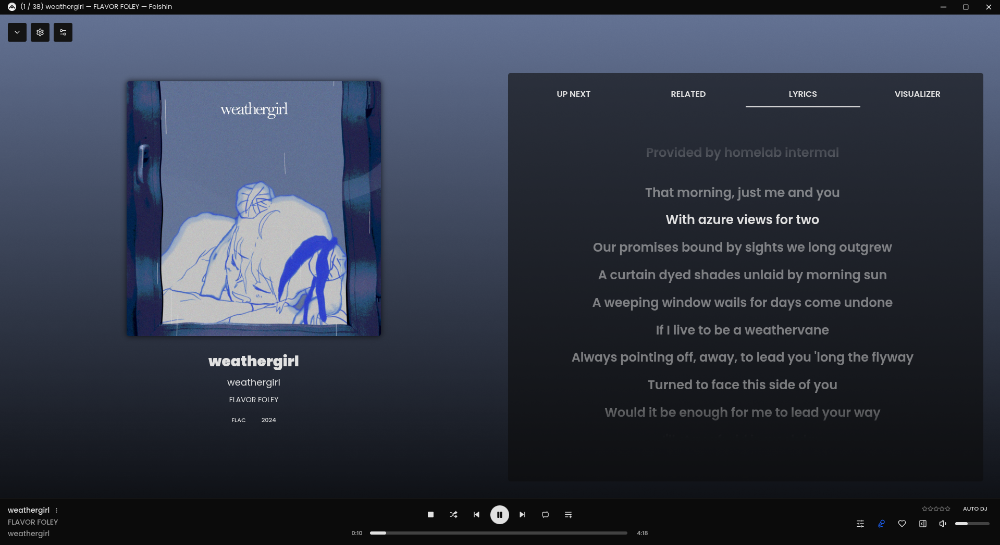
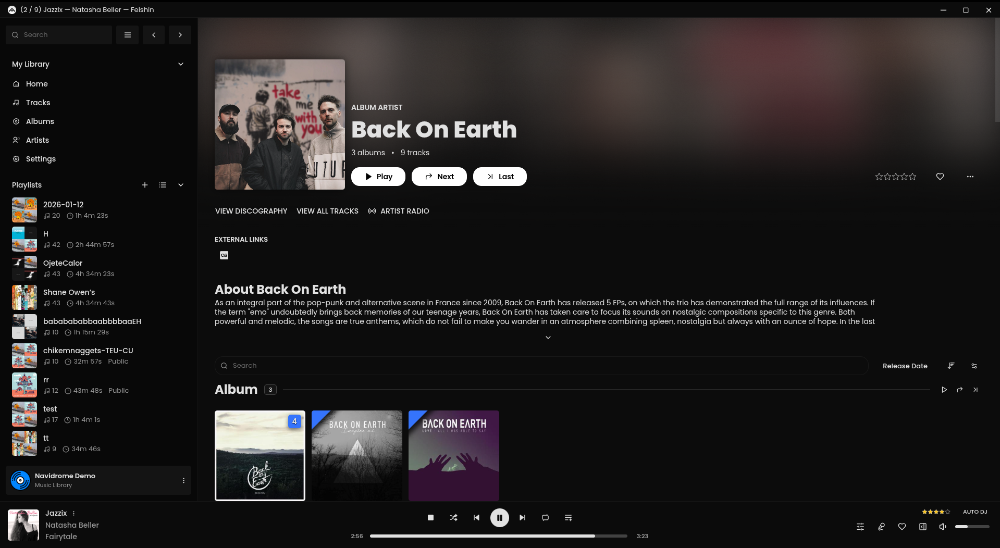
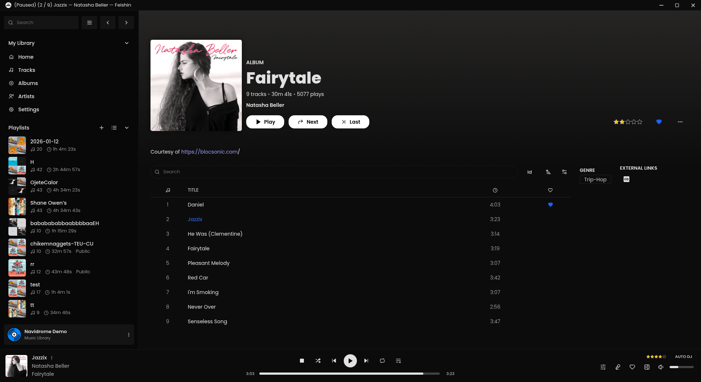
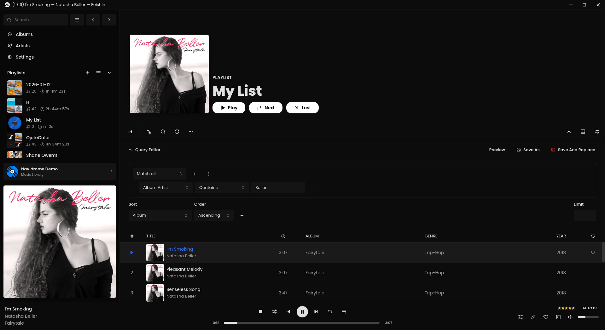

# Aurora

  <p align="center">
    <a href="https://github.com/sxxsxsg/feishin/blob/development/LICENSE">
      
    </a>
      <a href="https://github.com/sxxsxsg/feishin/releases">
      
    </a>
    <a href="https://github.com/sxxsxsg/feishin/releases">
      
    </a>
  </p>
  <p align="center">
    <a href="https://discord.gg/FVKpcMDy5f">
      
    </a>
    <a href="https://matrix.to/#/#sonixd:matrix.org">
      
    </a>
  </p>

---

Aurora 是 [Feishin](https://github.com/jeffvli/feishin) 的自用分支，Feishin 是 [Sonixd](https://github.com/jeffvli/sonixd) 的重写版。播放器、曲库界面和设置保持上游原样，只改客户端与服务器的交互方式和对外身份。

- 上游基线：Feishin `1.17.0`，提交 `98dbd79`（development 分支，2026-11-15）
- 本分支：`1.17.1`，分支 `development`，仓库 `sxxsxsg/feishin`
- Lu 于 2026-11-17 真机试过：能用，没发现问题

## 功能

- [x] MPV 播放后端
- [x] 网页播放后端
- [x] 现代界面
- [x] 播放记录 scrobble 到服务器
- [x] 智能歌单编辑器（Navidrome）
- [x] 支持同步和非同步歌词
- [ ] [提功能建议](https://github.com/sxxsxsg/feishin/issues)

## 截图

<a href="./media/preview_full_screen_player.png"></a> <a href="./media/preview_album_artist_detail.png"></a> <a href="./media/preview_album_detail.png"></a> <a href="./media/preview_smart_playlist.png"></a>

## 本分支的改动

**请求量。** 上游 Subsonic 客户端按专辑数扇出请求，不设并发上限，同一批读取还要做两遍（列表一次、计数一次）。Aurora 把批量读取限为每服务器 4 并发，列表和计数共用一次读取（在途去重，缓存 60 秒），不再为印一个总数把全库翻一遍：服务器不给的总数按未知处理。Subsonic 请求超时 30 秒。

**重试与刷新。** 查询重试上限 3 次，400 / 401 / 403 / 422 不重试；429 按 `Retry-After` 头等待，并让整个服务器一起冷却。列表刷新只失效当前服务器、当前资源，列表缓存延长（歌曲和歌单 1 分钟，其他列表 5 分钟）。

**播放。** Jukebox 状态轮询改成上一次完成后再约下一次，自适应退避 1 秒到 8 秒。波形 peaks 按服务器和歌曲缓存在 IndexedDB（LRU，上限 1000 条，约 128 MB），重播直接复用，不再为画波形重新下载、解码整首歌。

**改名。** 原项目因暴力请求被部分服务端封禁，改名是自用需求：只改客户端身份，让服务器看到一个不同的客户端。Subsonic 的 `c` 参数和转码名是 `Aurora`，Jellyfin 客户端头是 `Aurora`，应用 id 是 `com.aurora.music`，产品名是 `Aurora`，自定义协议是 `aurora:`，更新检查改指本分支。User-Agent 按决定原样不动。Aurora 与 Feishin 并存安装，设置全新，原安装不受影响。

## 开始使用

### 桌面端（推荐）

下载[最新 Aurora 发布版](https://github.com/sxxsxsg/feishin/releases/download/v1.17.1/Aurora-1.17.1-win-x64.zip)（Windows x64 便携 zip，227 MB）。解压后直接运行 exe，不用安装。本分支只发布 Windows 构建。桌面端是推荐的使用方式，同时支持 MPV 和网页播放后端，内置歌词获取。

启动后重新加一次服务器：Aurora 是独立应用，设置是全新的。原来的 Feishin 和它的设置不受影响。

#### macOS 说明

macOS 12（Monterey）及以上设备，解除应用隔离的方法见[这里](https://github.com/jeffvli/feishin/issues/104#issuecomment-1553914730)。

媒体键要能用，系统会提示允许 Aurora 成为受信任的辅助功能客户端。允许后需要重启 Aurora，隐私设置才生效。

#### Linux 说明

本分支不发布 Linux 安装包。上游 Feishin 提供 [Flathub](https://flathub.org/en/apps/org.jeffvli.feishin) 版和 AppImage，但那是上游 Feishin 的构建，不是 Aurora。Linux 上要用 Aurora，请从源码编译（见“开发”）。

### 网页版和 Docker

托管的网页版和预构建的 Docker 镜像属于上游 Feishin，不是 Aurora。网页版或 Docker 要用 Aurora，请从本仓库自己构建：

```bash
# 本地构建镜像
docker build -t feishin .
docker run --name feishin -p 9180:9180 feishin
```

#### Docker Compose

用 Docker Compose 安装可用下面这段，Portainer 同样适用。

```yaml
services:
    aurora:
        container_name: aurora
        image: 'feishin:latest'
        restart: unless-stopped
        environment:
            - SERVER_NAME=jellyfin # 预设服务器名
            - SERVER_LOCK=true # 为 true 且名称/类型/地址都设置时，只能改用户名和密码
            - SERVER_TYPE=jellyfin # 允许的值：jellyfin、navidrome、subsonic，大小写不敏感
            - SERVER_URL= # http://地址:端口 或 https://地址:端口
            - REMOTE_URL= # http://地址 或 https://地址
            - LEGACY_AUTHENTICATION=false # SERVER_LOCK 为 true 时，设置 Subsonic/OpenSubsonic 服务器的明文认证开关
            - ANALYTICS_DISABLED=true # 为 true 时禁用 Umami 统计
        ports:
            - 9180:9180
            # 只允许本机访问时，改用 - 127.0.0.1:9180:8190
```

### 配置

1. 启动时会提示选择 MPV 程序路径。没有安装 MPV 的话，可以从[这里](https://mpv.io/installation/)下载，或用系统支持的任意包管理器安装。填好路径后重启应用。

2. 重启后会提示选择服务器。点 `Open menu` 按钮，选 `Manage servers`，在弹窗里点 `Add server`，填好各项信息。服务器地址要写完整，带协议和端口（例如 `https://navidrome.my-server.com` 或 `http://192.168.0.1:4533`）。

- **Navidrome** - 想要最好的体验，添加服务器时勾选 "Save password"，并把 Navidrome 配置里的 `SessionTimeout` 设大一些（例如 72h）。
    - **Linux 用户** - 默认密码存储用 `libsecret`，也支持 `kwallet4/5/6`，但要在设置 > 窗口 > 密码/密钥存储里手动指定。

3. _可选_ - 想把 Feishin 挂在子路径下（而不是 `/`），传环境变量 `PUBLIC_PATH=PATH`。例如挂在 `/feishin` 就传 `PUBLIC_PATH=/feishin`。

4. _可选_ - 想写死服务器地址，传环境变量 `SERVER_NAME`、`SERVER_TYPE`（`jellyfin`、`navidrome`、`subsonic` 三选一）、`SERVER_URL`。想禁止用户改这些设置，再传 `SERVER_LOCK=true`，前提是前面三个值都已设置。`SERVER_LOCK=true` 时，还可以用 `LEGACY_AUTHENTICATION=true` 或 `LEGACY_AUTHENTICATION=false` 配置明文认证开关（只对 Subsonic/OpenSubsonic 服务器有效）。

5. _可选_ - 如果服务器对外地址和内部通信地址不一样，例如单独的 Navidrome `ShareURL`，把 `REMOTE_URL` 设为对外地址。

6. _可选_ - 想禁用 Docker/网页版里的 Umami 统计，设环境变量 `ANALYTICS_DISABLED=true`。启用后不会加载统计脚本，不做任何追踪。

7. _可选_ - 首次运行时，应用设置（主题、语言、侧边栏选项等）可以用环境变量覆盖。变量用 `FS_` 前缀（例如 `FS_GENERAL_THEME=defaultDark`、`FS_GENERAL_LANGUAGE=de`）。完整列表见[设置环境变量文档](docs/ENV_SETTINGS.md)。

## 常见问题

### MPV 不能用，或者在暂停/播放之间快速来回切换

先检查 MPV 程序路径对不对。进设置页重新设置路径，重启应用。如果还不行，试试重装 MPV。已知可用的版本包括 `v0.35.x` 和 `v0.36.x`，`v0.34.x` 是已知有问题的版本。

### Feishin 支持哪些音乐服务器？

Feishin 支持任何实现 [Navidrome](https://www.navidrome.org/)、[Jellyfin](https://jellyfin.org/) 或 [OpenSubsonic 兼容](https://opensubsonic.netlify.app/) API 的音乐服务器。

- [Navidrome](https://github.com/navidrome/navidrome)
- [Jellyfin](https://github.com/jellyfin/jellyfin)
- [OpenSubsonic](https://opensubsonic.netlify.app/) 兼容服务器，例如：
    - [Airsonic-Advanced](https://github.com/airsonic-advanced/airsonic-advanced)
    - [Ampache](https://ampache.org)
    - [Astiga](https://asti.ga/)
    - [Funkwhale](https://www.funkwhale.audio/)
    - [Gonic](https://github.com/sentriz/gonic)
    - [LMS](https://github.com/epoupon/lms)
    - [Nextcloud Music](https://apps.nextcloud.com/apps/music)
    - [Supysonic](https://github.com/spl0k/supysonic)
    - [Qm-Music](https://github.com/chenqimiao/qm-music)
    - 更多 (?)

- [Plex](https://www.plex.tv/media-server-downloads)
    - [Feishin fork by lux032](https://github.com/lux032/feishin) - Plex 原生不支持，用 lux032 的分支才能接 Plex。

### Linux 上出现 "The SUID sandbox helper binary was found, but is not configured correctly"

这是因为用户（非特权）命名空间被禁用（`sysctl kernel.unprivileged_userns_clone` 返回 0）。可以启用非特权命名空间，或者把 `chrome-sandbox` 设为 Setuid：

```bash
chmod 4755 chrome-sandbox
sudo chown root:root chrome-sandbox
```

Ubuntu 24.04 专门引入了影响命名空间工作的改动，可能的修复方法见 https://discourse.ubuntu.com/t/ubuntu-24-04-lts-noble-numbat-release-notes/39890#:~:text=security%20improvements%20 。

### 怎么添加自定义主题？

桌面端把 JSON 文件放进 Themes 文件夹即可（设置 → 通用 → 主题 → 打开文件夹）。格式和示例见[自定义主题文档](docs/CUSTOM_THEMES.md)。

## 开发

使用 Node `v23.11.0` 构建和测试。

本项目基于 [electron-vite](https://github.com/alex8088/electron-vite) 构建。

- `pnpm run dev` - 启动开发服务器
- `pnpm run dev:watch` - 以监听模式启动开发服务器（main / preload 热更新）
- `pnpm run start` - 以生产预览模式启动应用
- `pnpm run build` - 为桌面端构建应用
- `pnpm run build:electron` - 构建 electron 应用（main、preload、renderer）
- `pnpm run build:remote` - 构建 remote 应用
- `pnpm run build:web` - 构建独立网页应用（renderer）
- `pnpm run package` - 打包项目
- `pnpm run package:dev` - 本地打包开发版
- `pnpm run package:linux` - 本地打包 Linux 版
- `pnpm run package:mac` - 本地打包 Mac 版
- `pnpm run package:win` - 本地打包 Windows 版
- `pnpm run publish:linux` - 发布 Linux 版
- `pnpm run publish:linux:beta` - 发布 Linux 版（beta 通道）
- `pnpm run publish:linux-arm64` - 发布 Linux ARM64 版
- `pnpm run publish:linux-arm64:beta` - 发布 Linux ARM64 版（beta 通道）
- `pnpm run publish:mac` - 发布 Mac 版
- `pnpm run publish:mac:beta` - 发布 Mac 版（beta 通道）
- `pnpm run publish:win` - 发布 Windows 版
- `pnpm run publish:win:beta` - 发布 Windows 版（beta 通道）
- `pnpm run typecheck` - 类型检查
- `pnpm run typecheck:node` - 按 tsconfig.node.json 做类型检查
- `pnpm run typecheck:web` - 按 tsconfig.web.json 做类型检查
- `pnpm run lint` - 代码检查
- `pnpm run lint:fix` - 代码检查并自动修复
- `pnpm run i18next` - 生成 i18n 文件

本分支的发布件由 GitHub Actions 构建（`.github/workflows/publish-windows.yml`，只出 Windows x64 zip）。

## 翻译

本项目用 [Weblate](https://hosted.weblate.org/projects/feishin/) 做翻译。想参与翻译请访问链接提交。

## 许可证

[GNU 通用公共许可证 v3.0 ©](https://github.com/sxxsxsg/feishin/blob/development/LICENSE)
